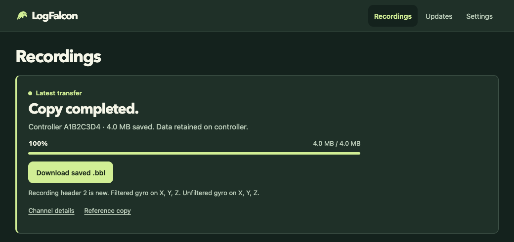

#  LogFalcon

**Collect blackbox logs from FPV drones running Betaflight, without a laptop.**

Between flights, plug your flight controller into a Raspberry Pi over USB. LogFalcon copies the recording from the controller’s internal flash to the Pi’s microSD card. Join the Pi’s Wi-Fi on your phone to download the `.bbl`. The original stays on the quad by default.

[Set up a Pi](#try-it-on-a-pi) · [Inside LogFalcon](#inside-logfalcon) · [Pilot guide](https://proeugene.github.io/logfalcon/guide.html)

*Dashboard after a simulated 4 MB transfer. The pilot can see that the copy finished, the second recording header is new and the controller kept its data.*

## Between flights

**See what’s new.** One flash dump can hold several flights. LogFalcon compares it with the last retained copy from that controller and can tell you when the contents are identical or a new recording header has appeared. Open **Channel details** to see which filtered and unfiltered gyro axes the header declares.

**Keep track of a flying session.** Give each quad a nickname and jot down what you changed between flights. Later, pick the recordings you want and download them as a ZIP with your notes and a manifest for each copy. To inspect the flight traces, open a saved `.bbl` in the Blackbox Viewer. [Betaflight App](https://app.betaflight.com/)

## Try it on a Pi

You’ll need a Pi Zero W or Zero 2 W, a 16 GB or larger microSD card, a 5 V supply, a USB OTG adapter, a data cable and a Betaflight controller that records to **internal SPI flash**. iNav copying is disabled. Controller-side SD cards and ArduPilot are unsupported. Physical testing of this revision is still open on both Pi models. [Compatibility](docs/FC_COMPATIBILITY_ANALYSIS.md) · [Test record](DEVELOPMENT_TESTING.md)

1. Build the SD image from this checkout, verify its checksum and flash a spare card. As of 27 November 2026, there’s no published SD image for this revision. [Image build instructions](DEVELOPMENT_TESTING.md#exact-image-baseline-and-comparison)
2. Power the Pi through **PWR IN**, join its Wi-Fi and open `http://log.falcon` or `http://192.168.4.1`. If **Set up Wi-Fi** opens, configure the hotspot or choose **Skip for now** to open **Recordings**. Before the first copy, confirm that `erase_after_sync` and `storage_pressure_cleanup` are both `false`. Upgrades preserve your settings. [Pilot setup guide](https://proeugene.github.io/logfalcon/guide.html#setup)
3. Stop recording and plug the controller into the Pi’s **USB / OTG data port**. Leave it connected while the copy runs. When the dashboard shows **Copy completed.**, choose **Download saved .bbl**.

## Inside LogFalcon

One Go binary runs the USB copier, web dashboard and status LED as separate Linux services. Restart the dashboard during a transfer and the copy carries on. When the dashboard comes back, it reads the latest progress from the same status file as the LED. [Architecture](docs/ARCHITECTURE.md#one-binary-separate-processes)

The copier counts the incoming bytes and compares their SHA-256 with a reread of the saved file. If you enable erasure, it saves the file and manifest to disk, then asks the controller for its flash usage again. If the size has changed or the controller can’t confirm it’s ready, LogFalcon keeps the copy and skips erasure. [Copy and recovery design](docs/ARCHITECTURE.md#copy-and-recovery-ordering) · [Test this behaviour](internal/sync/transfer_test.go#L362-L387)

With Go 1.27, run `make build` for a native binary or `make test` for the race-enabled suite. The tests run without a Pi. [Contributing](CONTRIBUTING.md) · [Protocol fixtures](internal/msp/testdata/README.md) · [AI-assisted development](docs/AI_ASSISTED_DEVELOPMENT.md) · [Signed offline updates](docs/OFFLINE_UPDATES.md)

Maintained by [Eugene Prokudin](https://github.com/proeugene). [Issues](https://github.com/proeugene/logfalcon/issues) · [MIT licence](LICENSE) · [Provenance](docs/PROVENANCE.md)
